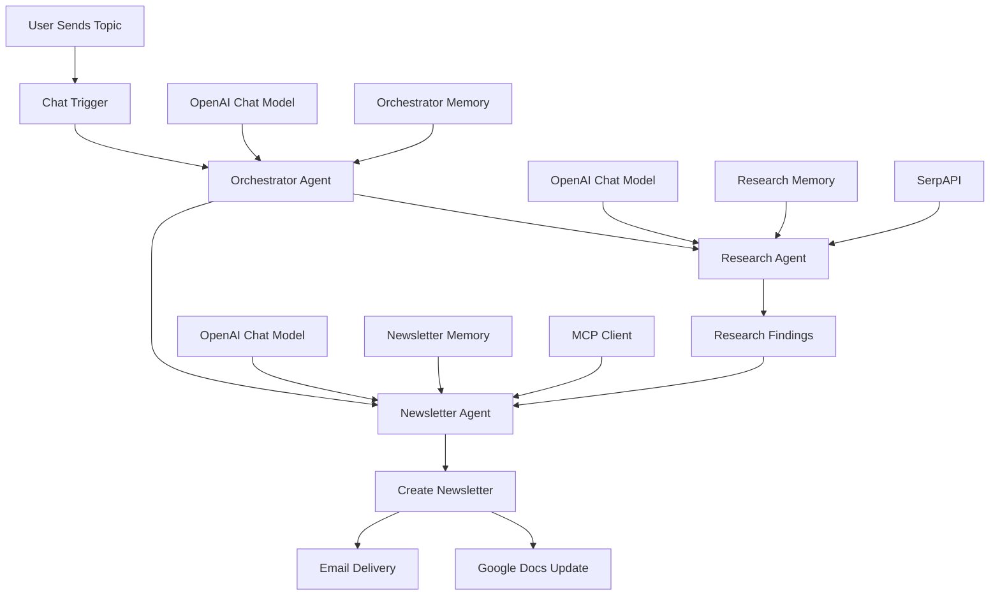

# 🤖 Orchestrator Pattern – Agent as Tool in n8n

An AI-powered research and newsletter automation workflow built using **n8n, OpenAI, SerpAPI, and MCP (Model Context Protocol)**.

## 📌 Project Overview

This project demonstrates the **Orchestrator Pattern – Agent as Tool** in n8n, where a central AI agent coordinates specialized agents to complete a multi-step task.

The workflow accepts a topic from the user, delegates research to a Research Agent, and uses a Newsletter Agent to create newsletter content and handle delivery and document-related actions through connected tools.

The goal is to demonstrate how multiple AI agents can collaborate within a single automated workflow, with the orchestrator managing task delegation.

## 🎯 Project Objectives

- Build a central AI orchestrator using n8n.
- Configure specialized AI agents as tools.
- Automate web research using SerpAPI.
- Generate newsletter content in HTML format.
- Connect newsletter-related actions through an MCP Client.
- Use memory to support contextual interactions.
- Explore multi-agent automation and task delegation.

## 🏗️ Workflow Architecture

*The diagram represents the intended task flow. Actual execution order and the specific email and document operations depend on the tools exposed through the MCP Client and the agent's execution decisions.*

## ⚙️ How the Workflow Works

### 1. User Input – Chat Trigger

The workflow starts when a user submits a topic through the n8n chat interface.

**Example:** “Research the latest developments in artificial intelligence and create a newsletter.”

### 2. Orchestrator Agent

The Orchestrator receives the request and coordinates the available agent tools.

Its system instructions require it to:

- Research the user's topic.
- Create a newsletter.
- Send the newsletter through Gmail.
- Update a Google Doc.
- Invoke each agent no more than once per request.

The orchestrator uses an OpenAI GPT-5-mini chat model and its own memory connection.

### 3. Research Agent

The Research Agent specializes in web research and information gathering.

**Tools and configuration:**
- OpenAI GPT-5-mini chat model
- SerpAPI for web searches
- Dedicated memory with a context window of 20
- An instruction limiting SerpAPI usage to no more than three calls

The agent gathers relevant information about the requested topic and returns its findings for the newsletter task.

### 4. Newsletter Agent

The Newsletter Agent handles newsletter creation and related publishing tasks.

Its configured responsibilities include:

- Creating newsletter content in HTML.
- Sending newsletter content by email.
- Creating a document containing the newsletter content.

The agent uses an OpenAI GPT-5-mini model, a dedicated memory connection, and an MCP Client tool.

**Note:** The specific Gmail and Google Docs actions available depend on the tools exposed by the configured MCP server.

### 5. Memory Management

The workflow contains three separate memory connections:

| Memory node | Connected agent | Context window |
|---|---|---:|
| Simple Memory | Orchestrator | 100 |
| Simple Memory1 | Research Agent | 20 |
| Simple Memory2 | Newsletter Agent | 20 |

These memory nodes provide separate conversational context for the orchestrator and its specialized agents.

## 🛠️ Technology Stack

| Technology | Purpose |
|---|---|
| n8n | Workflow automation and agent orchestration |
| OpenAI GPT-5-mini | Language model for all three agents |
| SerpAPI | Web search and research |
| MCP Client | Access to external tools exposed by an MCP server |
| AI Agent Tool nodes | Enable specialized agents to be called by the orchestrator |
| Simple Memory | Maintain contextual conversation history |

## 🚀 Setup Instructions

### Prerequisites

- An n8n Cloud account or self-hosted n8n instance
- OpenAI model access and credentials
- A SerpAPI account and API credentials
- An MCP server exposing the required newsletter publishing tools
- Appropriate Gmail and Google Docs access through the connected tools

### Import the Workflow

1. Download the exported workflow JSON from this repository.
2. Open your n8n workspace.
3. Navigate to **Overview** and select the option to import a workflow from a file.
4. Select the workflow JSON file.
5. Review the imported nodes and connections.
6. Configure your own OpenAI and SerpAPI credentials.
7. Configure the MCP Client with your own MCP server endpoint.
8. Verify that the connected MCP tools support the intended email and document operations.
9. Test the workflow with a sample topic.
10. Review the execution logs and verify the research, newsletter, email, and document steps.

**Security:** Never commit API keys, access tokens, passwords, or private MCP endpoints to a public repository. Review the exported workflow and replace personal connection details with safe placeholders before sharing.

## 🧪 Example Test

**Input:**

> Research the benefits and challenges of generative AI in education and create a newsletter.

**Expected workflow behavior:**

1. The Orchestrator interprets the request.
2. The Research Agent gathers information using SerpAPI.
3. The Newsletter Agent creates newsletter content based on the task instructions and available research.
4. The newsletter agent uses the connected publishing tools to carry out the requested email and document actions.
5. The workflow returns its final response through the chat interface.

*Actual results depend on model behavior, tool availability, credentials, and successful execution of the connected services.*

## 🌟 Key Learnings

Through this project, I explored:

- The Orchestrator Pattern in agentic AI systems.
- How an AI Agent can expose another agent as a callable tool.
- Delegating research and content creation to specialized agents.
- Integrating web search into AI-powered workflows.
- Connecting external tools through MCP.
- Managing context with separate memory nodes.
- Designing modular workflows for multi-step automation.

## 🔮 Potential Improvements

- Add structured outputs for research findings.
- Include source links and fact-checking in newsletter content.
- Add error handling and retry mechanisms for external services.
- Validate newsletter HTML before sending.
- Add approval before sending emails or publishing documents.
- Track execution status, latency, and API usage.
- Add tests for missing research results and failed tool calls.

⭐ If you find this project useful, feel free to star the repository and connect!
